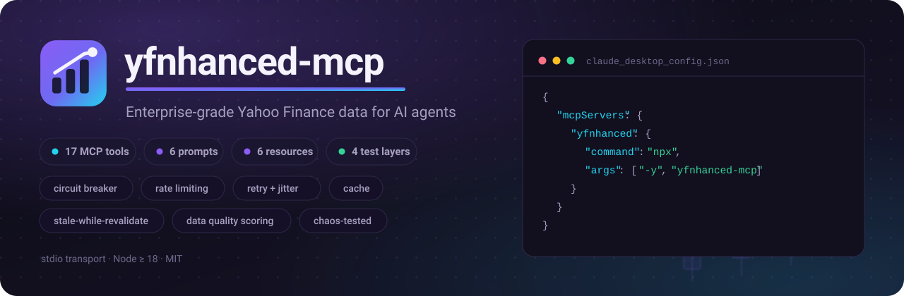
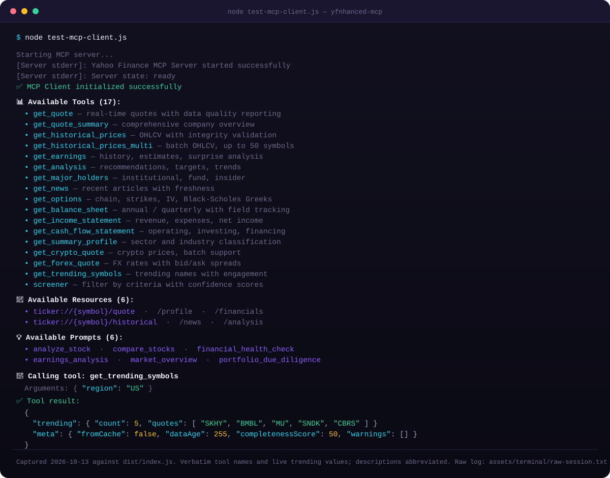
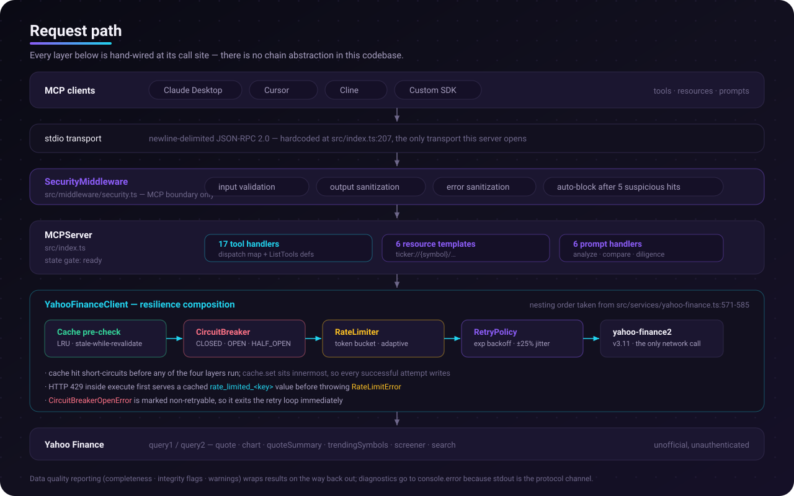

<p align="center">
  
</p>

<p align="center">
  <a href="https://www.npmjs.com/package/yfnhanced-mcp"></a>
  <a href="https://www.npmjs.com/package/yfnhanced-mcp"></a>
  <a href="LICENSE"></a>
  <a href="https://github.com/kanishka-namdeo/yfnhanced-mcp/actions/workflows/ci.yml"></a>
  <a href="https://modelcontextprotocol.io/"></a>
</p>

A [Model Context Protocol](https://modelcontextprotocol.io/) server that gives AI assistants financial data from Yahoo Finance, and wraps that unreliable, unofficial, unauthenticated API in the resilience patterns you would expect from a service: a circuit breaker, adaptive rate limiting, jittered retry, and a stale-while-revalidate cache. Every response carries a data-quality report, so a model can tell "market closed" apart from "the upstream call quietly returned nothing."

Written in TypeScript, ESM, zero database, no API key, single stdio process.

> **Read this before you build on it.** Yahoo Finance has no public API and rate-limits aggressively. This server is designed to degrade honestly rather than pretend — see [Known limitations](#known-limitations) for exactly what works, what is stubbed, and what is currently broken.

---

## Contents

- [Quick start](#quick-start)
- [See it working](#see-it-working)
- [Tools](#tools)
- [Architecture](#architecture)
- [Configuration](#configuration)
- [Data availability](#data-availability)
- [Testing](#testing)
- [Development](#development)
- [Known limitations](#known-limitations)
- [Documentation](#documentation)

---

## Quick start

### Claude Desktop

Add to `claude_desktop_config.json`:

```json
{
  "mcpServers": {
    "yfnhanced": {
      "command": "npx",
      "args": ["-y", "yfnhanced-mcp"]
    }
  }
}
```

Restart Claude Desktop. Ask it for a quote and it will call `get_quote`.

The same block works for Cursor, Cline, Windsurf, and any other MCP client that launches a stdio server.

### From source

```bash
git clone https://github.com/kanishka-namdeo/yfnhanced-mcp.git
cd yfnhanced-mcp
npm install
npm run build
npm start          # speaks JSON-RPC on stdio
```

Requires Node 18 or newer.

<details>
<summary><strong>A note on the two binary names</strong></summary>

`npm install -g yfnhanced-mcp` currently puts a `y-finance-mcp` command on your PATH — that is the name the published package declares. A matching `yfnhanced-mcp` alias was added in the repository and takes effect from the next publish. Until then, prefer the `npx` form above: `npx` resolves the package's single binary regardless of what it is called, so it works today and after the next release.

</details>

---

## See it working

A real session against the built server, captured 2026-10-13. Nothing here is mocked: the handshake, the tool inventory, and the trending symbols are exactly what `node test-mcp-client.js` printed.

<p align="center">
  
</p>

The verbatim log is in [`assets/terminal/raw-session.txt`](assets/terminal/raw-session.txt) so you can diff this picture against the real output.

The `get_quote` call from that same run is deliberately not shown: Yahoo rate-limited this IP, so every field came back `null` and the server reported `completenessScore: 0` with a warning. That behaviour is the point of the project — but it makes for a poor screenshot.

---

## Tools

17 tools, 6 prompt templates, and 6 resource URIs. All names are exactly as `tools/list` returns them.

**Quotes and history**

| Tool | Returns |
|---|---|
| `get_quote` | Real-time fields for up to 50 symbols, with a data-quality report |
| `get_quote_summary` | Comprehensive company overview from `quoteSummary` modules |
| `get_historical_prices` | OHLCV for a date range, with gap, split and null detection |
| `get_historical_prices_multi` | Batch OHLCV for up to 50 symbols |

**Fundamentals**

| Tool | Returns |
|---|---|
| `get_balance_sheet` | Assets, liabilities, equity; annual or quarterly |
| `get_income_statement` | Revenue, expenses, net income; falls back annual → quarterly |
| `get_cash_flow_statement` | Operating, investing, financing flows and free cash flow |
| `get_earnings` | Earnings history, estimates, and surprise analysis |
| `get_analysis` | Analyst recommendations, price targets, and trends |
| `get_major_holders` | Institutional, fund, and insider ownership with freshness |
| `get_summary_profile` | Company profile with sector and industry classification |

**Markets and sentiment**

| Tool | Returns |
|---|---|
| `get_news` | Recent articles with publisher, links, related tickers |
| `get_options` | Options chain with strikes, implied volatility, and Black-Scholes Greeks |
| `get_trending_symbols` | Trending names with volume and engagement metrics |
| `screener` | Filter by criteria with validation and confidence scores |
| `get_crypto_quote` | Crypto quotes — **currently returns stub data**, see below |
| `get_forex_quote` | FX rates with bid/ask — **currently returns stub data**, see below |

**Prompts**: `analyze_stock`, `compare_stocks`, `financial_health_check`, `earnings_analysis`, `market_overview`, `portfolio_due_diligence`

**Resources**: `ticker://{symbol}/quote`, `/profile`, `/financials`, `/historical`, `/news`, `/analysis` — all served as `application/json`.

Full parameter and return reference: [`docs/TOOLS.md`](docs/TOOLS.md).

---

## Architecture

<p align="center">
  
</p>

The load-bearing idea is that **resilience lives at the network boundary, not in the tools**. A tool handler asks for data and gets either data or a typed error with a `suggestedAction`; it never has to know about backoff or breaker state.

| Layer | What it actually does | Source |
|---|---|---|
| `CircuitBreaker` | Three states. Opens on a rolling-window failure count, transitions OPEN → HALF_OPEN *lazily* on the next call rather than on a timer. Its error is marked non-retryable so it exits the retry loop at once. | [`src/middleware/circuit-breaker.ts`](src/middleware/circuit-breaker.ts) |
| `RateLimiter` | A continuously-refilling token bucket, a fixed calendar-window tracker per minute and hour, and adaptive throttling driven by upstream response headers. Only *concurrency* queues (FIFO); exhaustion throws. | [`src/middleware/rate-limiter.ts`](src/middleware/rate-limiter.ts) |
| `RetryPolicy` | Exponential, linear, or fixed backoff with ±25% jitter and per-error multipliers — rate limits wait 2×, 502/503/504 wait 1.5×, cookie-consent failures wait 0.5×. | [`src/middleware/retry.ts`](src/middleware/retry.ts) |
| `Cache` | In-memory LRU with stale-while-revalidate. TTL by data type: quotes 60 s, historical 1 h, financials 24 h, news 5 min, analysis 1 h. A failed revalidation serves the stale entry instead of erroring. | [`src/middleware/cache.ts`](src/middleware/cache.ts) |
| `SecurityMiddleware` | Runs at the MCP boundary: symbol grammar, output and error sanitization, and an auto-block after five suspicious hits. | [`src/middleware/security.ts`](src/middleware/security.ts) |
| Data quality | Weighted completeness scoring, integrity flags, and warnings attached to every tool response as `meta`. | [`src/utils/data-completion.ts`](src/utils/data-completion.ts) |

Two things worth saying out loud, because they are unusual and a reader will otherwise assume a framework:

- **There is no middleware chain abstraction.** `MiddlewareChain` is declared in [`src/types/middleware.ts`](src/types/middleware.ts) and never implemented. The layers are nested by hand at two call sites in [`src/services/yahoo-finance.ts`](src/services/yahoo-finance.ts).
- **`cache.set` sits inside the retry loop**, so every successful attempt writes the cache. That is the current behaviour, documented rather than smoothed over.

Deeper narrative, state machines, and sequence diagrams: [`docs/ARCHITECTURE.md`](docs/ARCHITECTURE.md).

---

## Configuration

**Environment variables are the only configuration that takes effect today.** Names are `YF_MCP_` plus the upper-cased config path:

| Variable | Default | Effect |
|---|---|---|
| `YF_MCP_RATE_LIMIT_REQUESTS_PER_MINUTE` | `60` | Token-bucket refill ceiling |
| `YF_MCP_CACHE_TTL_QUOTES` | `60000` | Quote TTL in milliseconds |
| `YF_MCP_CACHE_MAX_CACHE_SIZE` | `1000` | LRU capacity |
| `YF_MCP_CIRCUIT_BREAKER_FAILURE_THRESHOLD` | `5` | Failures before the breaker opens |
| `YF_MCP_CIRCUIT_BREAKER_SUCCESS_THRESHOLD` | `3` | Successes in HALF_OPEN before closing |
| `YF_MCP_CIRCUIT_BREAKER_MONITORING_WINDOW` | `60000` | Rolling window in milliseconds |
| `YF_MCP_RETRY_MAX_RETRIES` | `3` | Retry attempts beyond the first |
| `YF_MCP_RETRY_BASE_DELAY` | `1000` | First backoff delay in milliseconds |
| `YF_MCP_CONFIG_PATH` | `./config.json` | Where to look for a config file |

```bash
YF_MCP_RATE_LIMIT_REQUESTS_PER_MINUTE=30 YF_MCP_CIRCUIT_BREAKER_FAILURE_THRESHOLD=8 npx -y yfnhanced-mcp
```

> **Known defect:** `config.json` is parsed, validated, and then **overwritten by defaults** before the server uses it, so file values have no effect. `.yaml` and `.yml` are not supported at all — the loader reaches for a `js-yaml` package that is not a dependency, and the failure is swallowed into a warning. Both are tracked in [`src/config/AGENTS.md`](src/config/AGENTS.md). The precedence bug is a one-function fix and a pull request would be very welcome.

Every knob that reaches runtime, and the longer list that is read but does nothing, is enumerated in [`src/config/AGENTS.md`](src/config/AGENTS.md). Full reference: [`docs/CONFIGURATION.md`](docs/CONFIGURATION.md) and [`README.config.md`](README.config.md).

---

## Data availability

| Area | Status |
|---|---|
| Quotes, historical OHLCV, earnings, analyst data, holders, news, options | Real data from Yahoo, subject to rate limits |
| Balance sheet / income statement / cash flow | Works, but schema validation can reject some symbols |
| `get_crypto_quote`, `get_forex_quote` | **Registered but stubbed** — the fetchers return hardcoded values and never call the network |
| Batch size | 50 symbols maximum. The `get_quote` schema advertises 100, and inputs of 51–100 are rejected at runtime by the validator |
| Upstream contract | Unofficial, unauthenticated, undocumented. Expect 429s and shape changes |

Field-by-field truth table: [`docs/DATA_VERIFICATION.md`](docs/DATA_VERIFICATION.md).

---

## Testing

Four layers exist in the repository — 32 unit, 9 integration, 5 end-to-end, and 6 chaos modules, run by one `npm test`. Coverage is gated at 85% for branches, functions, lines, and statements.

**The suite does not currently pass.** A full run on 2026-10-13 reported 45 of 52 suites failing, and `npm run lint` reports roughly 790 errors in `src/`. Most failures are stale test files importing exports that were renamed, plus timing-sensitive rate-limiter assertions. This is stated here rather than hidden because a green badge you cannot earn is worse than no badge — which is why there is no CI status shield at the top of this file. See [Known limitations](#known-limitations).

```bash
npm run build      # required first: e2e and chaos suites spawn dist/index.js
npm test
npm run test:coverage
```

---

## Development

```bash
npm run dev           # tsx watch mode
npm run build         # tsc -> dist/
npm run typecheck     # tsc --noEmit  (clean)
npm run lint          # eslint .      (currently failing, see above)
npm test
npm run test:coverage
node test-mcp-client.js   # manual stdio handshake against dist/index.js
```

Docker:

```bash
docker build -t yfnhanced-mcp .
docker run --rm -i yfnhanced-mcp
```

This repository uses a nested `AGENTS.md` documentation contract. Each folder's `AGENTS.md` is the binding local rule set for that subtree — start at the [root](AGENTS.md).

---

## Known limitations

Honest list, current as of 2026-10-13:

- **The verification gate is red.** `npm run lint` fails with ~790 errors and `npm test` fails 45 of 52 suites. `npm run typecheck` and `npm run build` are clean. CI has never run on `master` because the workflow only triggered on `main` and `develop`; that is fixed here, which is what exposed the above.
- **`config.json` is inert** due to a merge-precedence defect. Use environment variables.
- **Crypto and forex tools are stubs.** They are registered and callable but return hardcoded values.
- **stdio only.** No Streamable HTTP or SSE transport; the transport is hardcoded at `src/index.ts:207`.
- **Two middleware instantiations coexist.** The server builds a set for stats and shutdown; the client builds the set that is actually on the request path. Only the client's is exercised.
- **`winston` is a declared dependency and is imported nowhere.** All diagnostics go to `console.error`, because stdout is the protocol channel.
- **No cache persistence.** In-memory only; the `redis` and `file` config fields are never read, so a restart is a cold cache.
- **Unofficial upstream.** Nothing here is guaranteed by Yahoo.

---

## Documentation

| Document | Contents |
|---|---|
| [`docs/ARCHITECTURE.md`](docs/ARCHITECTURE.md) | Resilience mechanisms, state machines, data-quality and security design |
| [`docs/TOOLS.md`](docs/TOOLS.md) | Per-tool parameters and returns |
| [`docs/USAGE_GUIDE.md`](docs/USAGE_GUIDE.md) | Client integration and worked examples |
| [`docs/CONFIGURATION.md`](docs/CONFIGURATION.md) | Every option, default, and env var |
| [`docs/DATA_VERIFICATION.md`](docs/DATA_VERIFICATION.md) | Field-level availability truth table |
| [`README.config.md`](README.config.md) | Extended configuration reference |
| [`CONTRIBUTING.md`](CONTRIBUTING.md) | Setup, gates, and code style |
| [`SECURITY.md`](SECURITY.md) | Reporting a vulnerability |

## License

MIT — see [LICENSE](LICENSE).

## Acknowledgements

- [Model Context Protocol](https://modelcontextprotocol.io/) for the wire format.
- [`yahoo-finance2`](https://github.com/gadicc/yahoo-finance2) by Gadi Cohen, which does the unglamorous work of tracking Yahoo's endpoints.

*Not affiliated with, or endorsed by, Yahoo Inc. Yahoo Finance data is provided by Yahoo Inc. under its own terms.*
