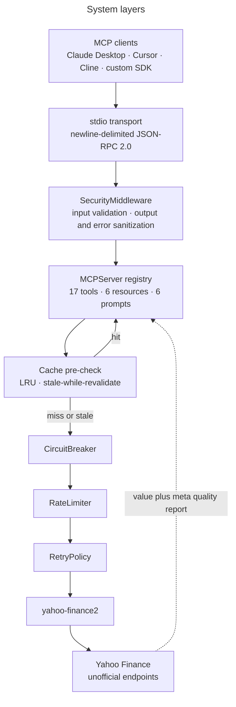
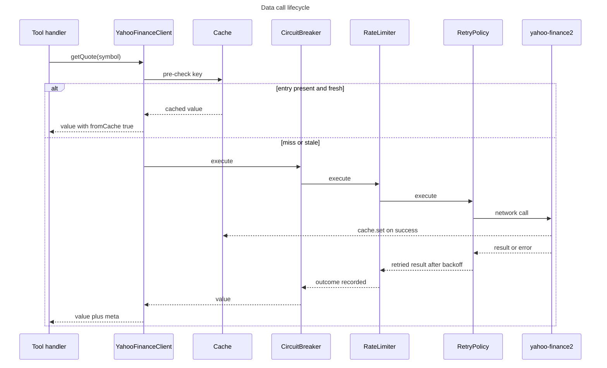
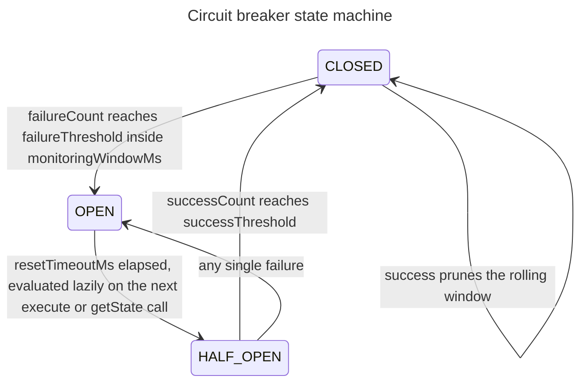
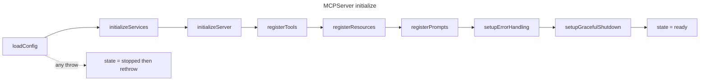

# Architecture

Deep dive into the Yahoo Finance MCP Server's architecture, resilience patterns, and data quality engine.

## Table of Contents

- [Overview](#overview)
- [Resilience Layer](#resilience-layer)
- [Data Quality Engine](#data-quality-engine)
- [Security & Validation](#security--validation)
- [Project Structure](#project-structure)

---

## Overview

The Yahoo Finance MCP Server is built with a layered architecture designed for production-grade resilience and data quality:



The order inside the resilience stack is the one the code actually nests — `CircuitBreaker` outermost, then `RateLimiter`, then `RetryPolicy` — composed by hand at [`src/services/yahoo-finance.ts`](../src/services/yahoo-finance.ts). There is no chain abstraction: `MiddlewareChain` is declared in [`src/types/middleware.ts`](../src/types/middleware.ts) and never implemented.

---

## Resilience Layer

The resilience layer handles real-world API unreliability through multiple strategies:

### Request Flow

A cache hit never touches the network stack. On a miss the four layers nest in this order, and `cache.set` runs innermost so every successful attempt writes:



### Circuit breaker states



The OPEN to HALF_OPEN edge has no timer behind it; the transition is decided when a call arrives. `CircuitBreakerOpenError` carries `isRetryable = false`, so an open breaker exits the retry loop immediately instead of burning attempts.

### Startup ordering



`state` gates every request path, so handlers registered after the ready flag would be unreachable and any earlier one leaves a half-initialized server answering requests.

### Rate Limiter

**Location:** [`src/middleware/rate-limiter.ts`](../src/middleware/rate-limiter.ts)

The rate limiter implements three strategies to prevent overwhelming the API:

#### 1. Token Bucket Algorithm

Smooth burst handling with token refill rate:

```typescript
interface TokenBucket {
  tokens: number;           // Current tokens available
  maxTokens: number;       // Maximum token capacity
  refillRate: number;       // Tokens added per millisecond
  lastRefill: number;       // Last refill timestamp
}
```

**How it works:**
- Tokens refilled continuously at `refillRate`
- Each request consumes one token
- Burst allowed up to `maxTokens`
- After burst, requests throttled until tokens refill

**Configuration:**
```json
{
  "rateLimit": {
    "requestsPerMinute": 60,
    "requestsPerHour": 1500,
    "tokenRefillRate": 1.0,
    "burstLimit": 5
  }
}
```

#### 2. Adaptive Throttling

Adjusts limits based on API responses:

```typescript
if (response.status === 429) {
  currentLimit *= 0.8;  // Reduce limit by 20%
} else if (successCount > threshold) {
  currentLimit *= 1.1;  // Gradually increase limit
}
```

**Benefits:**
- Automatically reduces rate when API returns 429
- Gradually recovers when API is stable
- Prevents permanent rate limit reductions

#### 3. Per-Endpoint Tracking

Prevents hotspot abuse by tracking requests per endpoint:

```typescript
interface EndpointStats {
  [endpoint: string]: {
    requestCount: number;
    lastRequest: number;
  };
}
```

**Features:**
- Separate limits for different endpoints
- Prevents single endpoint from dominating quota
- Fair resource distribution

---

### Circuit Breaker

**Location:** [`src/middleware/circuit-breaker.ts`](../src/middleware/circuit-breaker.ts)

Three-state pattern prevents cascading failures:

#### States

**1. Closed (Normal Operation)**
```
Requests flow through
├─ Success: Reset failure count
└─ Failure: Increment failure count
    └─ If failures > threshold → Open
```

**2. Open (Fail Fast)**
```
Requests rejected immediately
├─ Wait for resetTimeout
└─ After timeout → Half-Open
```

**3. Half-Open (Testing Recovery)**
```
Allow limited requests (test probes)
├─ Success: Reset → Closed
└─ Failure: Back to Open
```

**Configuration:**
```json
{
  "circuitBreaker": {
    "failureThreshold": 5,
    "monitoringWindow": 60000,
    "successThreshold": 3,
    "resetTimeoutMs": 60000
  }
}
```

**How it works:**
- Opens after `failureThreshold` failures in `monitoringWindow`
- Stays open for `resetTimeoutMs`
- Requires `successThreshold` consecutive successes to close
- Prevents cascading failures and thundering herd

---

### Retry Logic

**Location:** [`src/middleware/retry.ts`](../src/middleware/retry.ts)

Exponential backoff with jitter for transient failures:

#### Retry Strategy

```typescript
const delay = Math.min(
  baseDelay * Math.pow(2, attempt) * (1 + Math.random() * jitter),
  maxDelay
);
```

**Example delays (baseDelay=1000ms, jitter=0.1):**
- Attempt 1: 1000-1100ms
- Attempt 2: 2000-2200ms
- Attempt 3: 4000-4400ms

**Retryable Status Codes:**
- `429` - Too Many Requests
- `500` - Internal Server Error
- `502` - Bad Gateway
- `503` - Service Unavailable
- `504` - Gateway Timeout

**Retryable Errors:**
- `ECONNRESET` - Connection reset
- `ETIMEDOUT` - Connection timeout
- `ECONNREFUSED` - Connection refused

**Configuration:**
```json
{
  "retry": {
    "maxRetries": 3,
    "baseDelay": 1000,
    "maxDelay": 10000,
    "jitter": 0.1
  }
}
```

---

### Cache Layer

**Location:** [`src/middleware/cache.ts`](../src/middleware/cache.ts)

Tiered TTL strategy with automatic fallback:

#### TTL Strategy

```typescript
interface CacheConfig {
  ttlQuotes: number;       // 60 seconds (1 minute)
  ttlHistorical: number;   // 3600000ms (1 hour)
  ttlFinancials: number;   // 86400000ms (24 hours)
  ttlNews: number;         // 300000ms (5 minutes)
  maxCacheSize: number;     // Maximum number of entries
}
```

**Rationale:**
- **Quotes**: Real-time data needs freshness (1 min TTL)
- **Historical**: Historical data doesn't change (1 hour TTL)
- **Financials**: Financial reports update quarterly (24 hour TTL)
- **News**: Articles don't change but need freshness (5 min TTL)

#### Cache Strategy

**LRU Eviction:**
```typescript
if (cache.size >= maxCacheSize) {
  const oldestKey = cache.keys().next().value;
  cache.delete(oldestKey);
}
```

**Automatic Fallback:**
```typescript
if (apiRateLimited && cache.has(key)) {
  return cache.get(key);  // Serve stale data
}
```

**Features:**
- In-memory cache (no persistence required)
- LRU eviction when full
- Automatic fallback when API is rate-limited
- Cache hit ratio tracking

---

## Data Quality Engine

**Location:** [`src/utils/data-quality.ts`](../src/utils/data-quality.ts)

The DataQualityReporter provides intelligence about every data point:

### Completeness Scoring

Weighted scoring based on field importance:

```typescript
interface FieldWeights {
  critical: 2.0;    // symbol, price
  important: 1.5;   // change, volume, marketCap
  standard: 1.0;      // all other fields
}
```

**Calculation:**
```typescript
const score = (
  criticalFields * 2.0 +
  importantFields * 1.5 +
  standardFields * 1.0
) / totalFields * 100;
```

**Score Interpretation:**
- **90-100**: High quality, use confidently
- **70-89**: Good quality, minor gaps acceptable
- **50-69**: Medium quality, review before use
- **<50**: Low quality, use with caution

---

### Integrity Validation

Detects data anomalies and corruption:

#### Price Integrity Checks

```typescript
function validatePrice(data: Quote): IntegrityCheck[] {
  const checks = [];

  if (data.high < data.low) {
    checks.push({
      type: 'INVALID_RANGE',
      message: 'High price is less than low price',
      severity: 'HIGH'
    });
  }

  if (data.close < data.low || data.close > data.high) {
    checks.push({
      type: 'CLOSE_OUTSIDE_RANGE',
      message: 'Close price outside high-low range',
      severity: 'MEDIUM'
    });
  }

  if (data.price < 0) {
    checks.push({
      type: 'NEGATIVE_PRICE',
      message: 'Negative price detected',
      severity: 'HIGH'
    });
  }

  return checks;
}
```

#### Volume Integrity Checks

```typescript
if (data.price === 0 && data.volume > 0) {
  return {
    type: 'ZERO_PRICE_WITH_VOLUME',
    message: 'Zero price with non-zero volume',
    severity: 'MEDIUM'
  };
}
```

#### Null Value Checks

```typescript
const criticalFields = ['symbol', 'price'];
const missingFields = criticalFields.filter(field => data[field] == null);

if (missingFields.length > 0) {
  return {
    type: 'MISSING_CRITICAL_FIELDS',
    message: `Missing critical fields: ${missingFields.join(', ')}`,
    severity: 'HIGH'
  };
}
```

---

### Source Reliability

Classifies data sources based on quality metrics:

```typescript
interface SourceReliability {
  score: number;
  classification: 'HIGH' | 'MEDIUM' | 'LOW';
  recommendations: string[];
}
```

**Classification Rules:**

| Score | Classification | Criteria |
|-------|---------------|-----------|
| ≥90 | HIGH | ≥90% complete, fresh, no missing critical fields |
| 70-89 | MEDIUM | ≥70% complete, fresh, ≤2 missing fields |
| <70 | LOW | Below thresholds, use with caution |

**Recommendations:**

```typescript
if (classification === 'HIGH') {
  return 'Use confidently for analysis and decisions';
} else if (classification === 'MEDIUM') {
  return 'Acceptable for screening, verify critical fields before decisions';
} else {
  return 'Review data quality, consider alternative sources';
}
```

---

## Security & Validation

**Location:** [`src/utils/security.ts`](../src/utils/security.ts)

### Input Validation

Prevents injection attacks and malformed inputs:

```typescript
function validateSymbol(symbol: string): ValidationResult {
  if (!/^[A-Z0-9.-]{1,10}$/i.test(symbol)) {
    return {
      valid: false,
      error: 'Invalid symbol format'
    };
  }
  return { valid: true };
}
```

**Validations:**
- Symbol format (alphanumeric, length limits)
- Date range validation
- Numeric range checks
- SQL injection prevention
- XSS prevention

---

### Output Sanitization

Removes sensitive data from responses:

```typescript
function sanitizeResponse(data: any): any {
  const sensitiveFields = [
    'password',
    'apiKey',
    'token',
    'sessionId'
  ];

  const sanitized = { ...data };

  sensitiveFields.forEach(field => {
    delete sanitized[field];
  });

  return sanitized;
}
```

---

### Path Traversal Prevention

Prevents unauthorized file access:

```typescript
function validatePath(path: string): boolean {
  const normalized = path.replace(/[\/\\]/g, '');
  return normalized === path && !path.includes('..');
}
```

---

## Project Structure

```
src/
├── config/              # Configuration management
│   ├── index.ts        # Configuration loader and validator
│   └── schema.ts       # Configuration schemas (Zod)
│
├── middleware/          # Resilience layer
│   ├── rate-limiter.ts  # Token bucket + adaptive + per-endpoint
│   ├── circuit-breaker.ts  # 3-state pattern
│   ├── retry.ts        # Exponential backoff + jitter
│   └── cache.ts        # Tiered TTL + LRU eviction
│
├── prompts/            # Pre-built analysis prompts
│   ├── analyze_stock.ts
│   ├── compare_stocks.ts
│   └── ...
│
├── schemas/            # Zod validation schemas
│   ├── quotes.ts
│   ├── historical.ts
│   ├── financials.ts
│   └── ...
│
├── services/           # Yahoo Finance API client
│   └── yahoo-finance.ts
│       ├── YahooFinanceClient
│       ├── Error handling
│       └── Rate limit awareness
│
├── tools/              # MCP tool implementations
│   ├── quotes.ts       # Real-time quotes
│   ├── historical.ts    # Historical prices
│   ├── financials.ts   # Financial statements
│   ├── earnings.ts     # Earnings data
│   ├── analysis.ts      # Analyst data
│   ├── news.ts         # Company news
│   ├── options.ts      # Options chains
│   ├── holders.ts      # Holder information
│   ├── market.ts       # Screener & trending
│   └── summary.ts      # Company overview
│
├── types/              # TypeScript definitions
│   ├── yahoo-finance.ts
│   ├── middleware.ts
│   └── errors.ts
│
├── utils/              # Utilities
│   ├── data-quality.ts  # Completeness & integrity
│   ├── security.ts      # Validation & sanitization
│   ├── formatting.ts    # Number/date formatting
│   └── error-classifier.ts  # Error classification
│
└── index.ts            # Server entry point
    ├── MCP server setup
    ├── Tool registration
    ├── Graceful shutdown
    └── Metrics endpoint
```

---

## Design Patterns

The architecture follows these proven patterns:

1. **Circuit Breaker** - Prevents cascading failures
2. **Token Bucket** - Smooth rate limiting
3. **Exponential Backoff** - Retry with jitter
4. **LRU Cache** - Efficient cache eviction
5. **Strategy Pattern** - Multiple rate limiting strategies
6. **Observer Pattern** - Event-driven metrics
7. **Factory Pattern** - Tool instantiation
8. **Middleware Pattern** - Request/response pipeline

For more information on configuration, see [CONFIGURATION.md](CONFIGURATION.md).
